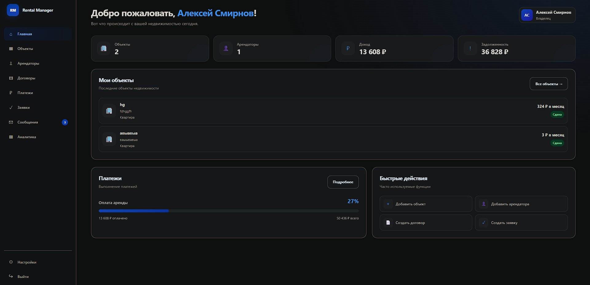

# Rental Manager

**Статус:** В разработке  
**Учебная группа:** К-ИСП-231  
**Учебный год:** 2026–2027

## 1. Описание проекта

Rental Manager — веб-приложение для управления арендной недвижимостью, позволяющее вести учёт объектов недвижимости, арендаторов, договоров, платежей и заявок в единой системе.

## 2. Функциональные возможности

### Реализованные функции
- [x] Регистрация пользователей
- [x] Авторизация
- [x] Управление объектами недвижимости
- [x] Управление арендаторами
- [x] Работа с договорами аренды
- [x] Учёт платежей
- [x] Обработка заявок
- [x] Обмен сообщениями
- [x] Просмотр аналитики

### Планируемые функции
- [ ] Расширенный поиск и фильтрация
- [ ] Уведомления о платежах и договорах
- [ ] Генерация договоров в PDF
- [ ] Шифрование договоров
- [ ] Электронная подпись документов
- [ ] Разработка физического прототипа замка двери для удаленного доступа

## 3. Технологический стек

| Компонент | Технология |
|-----------|------------|
| Frontend | HTML, CSS, JavaScript |
| Backend | Node.js, Express.js |
| ORM | Prisma |
| База данных | PostgreSQL |
| API | REST API |
| Контроль версий | Git / GitHub |

## 4. Дизайн и прототипы

Прототип дизайна пользовательского интерфейса реализован в веб-приложении.

Основные экраны:
- Главная страница
- Страница авторизации и регистрации
- Объекты недвижимости
- Арендаторы
- Договоры
- Платежи
- Заявки
- Сообщения
- Аналитика

**Главная страница:**



## 5. База данных

**СУБД:** PostgreSQL

В базе данных используются следующие сущности:
- Пользователи
- Объекты недвижимости
- Арендаторы
- Договоры аренды
- Платежи
- Заявки
- Сообщения

**Документация:**
- [Описание базы данных](docs/database.md)
- [Схема базы данных](docs/er-diagram.md)
- [Схема Prisma](server/prisma/schema.prisma)

## 6. Архитектура и структура проекта

```text
rental-property/
├── client/                   # Клиентская часть
│   ├── css/                  # Стили
│   ├── js/                   # JavaScript-файлы
│   ├── pages/                # Страницы приложения
│   ├── index.html            # Главная страница
│   └── script.js             # Общая логика
├── server/                   # Серверная часть
│   ├── routes/               # API-маршруты
│   ├── prisma/               # Схема и миграции БД
│   └── server.js             # Запуск сервера
├── docs/                     # Документация
│   └── images/               # Скриншоты
├── README.md
└── .gitignore
```

## 7. Установка и запуск

### Требования
- Node.js
- npm
- PostgreSQL
- Git

### Установка

1. Клонировать репозиторий:

   ```bash
   git clone <https://github.com/askenq/rental-property-management>
   ```

2. Перейти в каталог проекта.
3. Установить зависимости в каталоге `server` командой `npm install`.
4. Настроить подключение к PostgreSQL в файле `.env`.
5. Выполнить миграции базы данных.
6. Запустить сервер командой `node server.js`.
7. Открыть приложение в браузере по адресу `http://localhost:3000`.

## 8. Команда проекта

| Участник | Зона ответственности | GitHub |
|----------|---------------------|--------|
| Григорьев А.Е. | Координация команды, Backend и база данных | [Профиль](https://github.com/askenq) |
| Шаихов Д.Е. | Backend и база данных | [Профиль](https://github.com/satler13) |
| Жарников М.Д. | Frontend и Backend | [Профиль](https://github.com/maxzhar1) |
